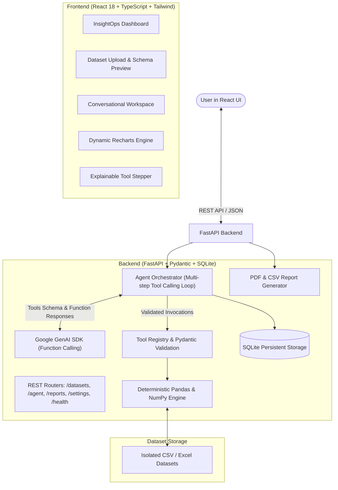
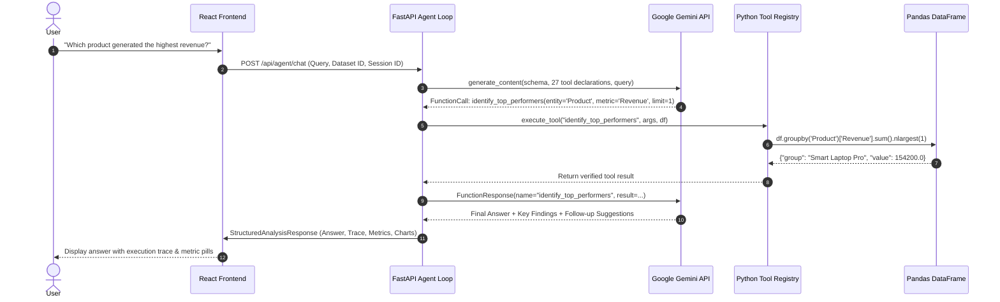

# InsightOps – AI-Powered Data Analyst Agent

[](https://www.python.org/)
[](https://fastapi.tiangolo.com/)
[](https://react.dev/)
[](https://www.typescriptlang.org/)
[](https://vitejs.dev/)
[](https://tailwindcss.com/)
[](https://github.com/googleapis/python-genai)
[]()

> **InsightOps** is a production-grade autonomous Data Analyst Agent that empowers users to upload real-world CSV and Excel datasets and interact with them using conversational natural language. The architecture integrates Google Gemini function calling with a sandboxed Python data engine to enforce **zero mathematical hallucinations**.

---

## 1. Problem Statement & Motivation

Traditional LLM applications attempt to calculate metrics (sums, averages, margins, rankings) purely through token prediction, frequently producing confident mathematical hallucinations. 

**InsightOps solves this:**
- The LLM never computes arithmetic directly.
- The LLM acts strictly as an **Orchestrator and Natural Language Interpreter**: it interprets the user's intent, inspects the schema, selects appropriate tools from a 27-function registry, passes validated parameters, and interprets the deterministic Pandas results.
- If a question requires multiple operations (e.g., *"Find the best-performing region and compare its monthly sales with others"*), the agent performs a **multi-step reasoning loop** across tools before returning a synthesized response with an interactive execution trace and dynamic visualizations.

---

## 2. High-Level Architecture



---

## 3. Core Features

- **Natural Language Data Understanding**: Ask exploratory questions in plain English without writing SQL or Python.
- **27 Predefined & Validated Python Tools**:
  - **Dataset Inspection**: Shape, columns, data types, null counts, duplicate records, unique frequencies.
  - **Statistical Analysis**: Mean, median, mode, standard deviation, variance, min/max/IQR ranges, Pearson correlation coefficient.
  - **Business Analysis**: Totals, averages, multi-category groupings, category comparisons, percentage change / growth rates, top performers, bottom performers, IQR/Z-score outlier detection.
  - **Visualization Generators**: Bar charts, multi-series line charts, pie/donut charts, frequency histograms, scatter plots.
  - **Reporting**: Comprehensive executive summaries and data quality hygiene assessments.
- **Multi-Step Agent Reasoning**: Coordinates sequential tool calls to satisfy complex business questions with a strict execution cap to prevent infinite loops.
- **Explainability & Execution Trace**: Displays the exact tools, arguments, and intermediate results used to answer each query.
- **Conversational Memory**: Maintains session context across follow-up queries (e.g., *"What about its monthly performance?"*).
- **Dynamic Recharts Visualization**: Automatically renders charts from structured configurations returned by Python visualization tools.
- **Executive Report Generation**: Downloads publication-ready PDF documents (via ReportLab) and CSV metric exports.
- **Modern SaaS Interface**: Clean, minimalist UI inspired by Linear, Notion, and modern analytics platforms with light/dark theme support.
- **Flexible Configuration**: Set the Gemini API key and model dynamically via `.env` or through the interactive Settings modal.

---

## 4. How LLM Function Calling Works in InsightOps



---

## 5. Technology Stack

### Backend
- **Language**: Python 3.11+
- **Framework**: FastAPI (REST API with interactive Swagger UI)
- **Validation**: Pydantic v2
- **Data Engine**: Pandas & NumPy
- **Server**: Uvicorn
- **Persistence**: SQLite (sessions, chat history, tool traces, report metadata)
- **PDF Generation**: ReportLab
- **LLM Integration**: Google GenAI SDK (`google-genai`)

### Frontend
- **Framework**: React 18 with Vite
- **Language**: TypeScript
- **Styling**: Tailwind CSS
- **Visualizations**: Recharts
- **Icons**: Lucide React

---

## 6. Project Structure

```
InsightOps/
├── backend/
│   ├── app/
│   │   ├── main.py                   # FastAPI initialization & routers
│   │   ├── config.py                 # Pydantic Settings & environment variables
│   │   ├── api/
│   │   │   ├── health.py             # Health check endpoint
│   │   │   ├── datasets.py           # Upload, preview, & schema endpoints
│   │   │   ├── agent.py              # Chat, sessions, & history endpoints
│   │   │   ├── reports.py            # Report generation & PDF download
│   │   │   └── settings_router.py    # Dynamic API key & model settings
│   │   ├── agents/
│   │   │   ├── llm_client.py         # Google GenAI SDK wrapper
│   │   │   ├── agent_executor.py     # Multi-step reasoning orchestrator
│   │   │   ├── tool_registry.py      # Predefined tools & Pydantic validators
│   │   │   ├── memory.py             # Conversational memory & history
│   │   │   └── prompts.py            # System directives & schema injection
│   │   ├── tools/
│   │   │   ├── base.py               # Fuzzy column resolution & type sanitizer
│   │   │   ├── inspection.py         # Dataset inspection functions
│   │   │   ├── statistics.py         # Statistical analysis functions
│   │   │   ├── business_analysis.py  # Business & aggregation functions
│   │   │   ├── visualization.py      # Dynamic chart configuration builders
│   │   │   └── reporting.py          # Summary & data hygiene reports
│   │   ├── services/
│   │   │   ├── dataset_service.py    # File upload, caching, & preview
│   │   │   └── report_service.py     # PDF & CSV generation engine
│   │   ├── models/
│   │   │   ├── schemas.py            # API request/response models
│   │   │   └── tool_schemas.py       # Pydantic models for tool arguments
│   │   └── database/
│   │       └── connection.py         # SQLite connection & table schemas
│   ├── tests/                        # 34 Pytest unit & integration tests
│   │   ├── conftest.py
│   │   ├── test_inspection_tools.py
│   │   ├── test_statistics_tools.py
│   │   ├── test_business_tools.py
│   │   ├── test_visualization_tools.py
│   │   ├── test_agent_workflow.py
│   │   └── test_api_endpoints.py
│   ├── requirements.txt
│   └── .env.example
├── frontend/
│   ├── src/
│   │   ├── components/
│   │   │   ├── Sidebar.tsx
│   │   │   ├── Navbar.tsx
│   │   │   ├── DataTable.tsx
│   │   │   ├── ChartRenderer.tsx
│   │   │   ├── ExecutionTrace.tsx
│   │   │   └── SettingsModal.tsx
│   │   ├── pages/
│   │   │   ├── DashboardPage.tsx
│   │   │   ├── DatasetsPage.tsx
│   │   │   ├── AnalystPage.tsx
│   │   │   └── ReportsPage.tsx
│   │   ├── services/
│   │   │   └── api.ts
│   │   ├── types/
│   │   │   └── index.ts
│   │   ├── App.tsx
│   │   └── main.tsx
│   ├── package.json
│   ├── tailwind.config.js
│   ├── tsconfig.json
│   └── vite.config.ts
├── sample_data/
│   ├── ecommerce_sales.csv           # 1,200 orders across regions & categories
│   ├── supermarket_sales.csv         # 1,000 retail transaction records
│   └── generate_samples.py           # Reproducible data generator
├── docs/
│   └── architecture.md
├── run_backend.ps1
├── run_frontend.ps1
├── start_all.ps1
├── README.md
└── .gitignore
```

---

## 7. Sample Datasets Included

InsightOps comes pre-seeded with two realistic business datasets containing minor real-world quirks (NaNs, dates, categorical variations) for immediate testing:

1. **`ecommerce_sales.csv`** (1,200 records):
   - Columns: `Order_ID`, `Order_Date`, `Product`, `Category`, `Region`, `Quantity`, `Unit_Price`, `Revenue`, `Discount_Rate`, `Profit`, `Customer_Segment`.
2. **`supermarket_sales.csv`** (1,000 records):
   - Columns: `Invoice_ID`, `Branch`, `City`, `Customer_Type`, `Gender`, `Product_Line`, `Unit_Price`, `Quantity`, `Tax_5_Percent`, `Total`, `Date`, `Time`, `Payment_Method`, `Rating`.

---

## 8. Installation & Setup Guide

### Prerequisites
- Windows 10/11 or macOS / Linux
- Python 3.11+
- Node.js 18+

### Step 1: Clone or Navigate to Project
```powershell
cd C:\InsightOps
```

### Step 2: Configure Environment Variables
Create a `.env` file in `backend/` or enter your API key directly in the UI Settings modal:
```env
GEMINI_API_KEY=your_google_gemini_api_key_here
GEMINI_MODEL=gemini-2.5-flash
MAX_TOOL_STEPS=8
MAX_UPLOAD_SIZE_MB=50
```
> *Get a free Gemini API key at [Google AI Studio](https://aistudio.google.com/app/apikey).*

### Step 3: Run Backend (FastAPI)
Using PowerShell:
```powershell
.\run_backend.ps1
```
Or manually:
```powershell
$env:PYTHONPATH = "C:\InsightOps\backend"
python -m uvicorn app.main:app --host 127.0.0.1 --port 8000 --reload
```
- Backend API: `http://127.0.0.1:8000`
- Interactive Swagger UI: `http://127.0.0.1:8000/docs`

### Step 4: Run Frontend (React + Vite)
In a second PowerShell window:
```powershell
.\run_frontend.ps1
```
Or manually:
```powershell
cd frontend
npm run dev
```
- Frontend UI: `http://localhost:5173`

*(Optional) Launch both backend and frontend simultaneously:*
```powershell
.\start_all.ps1
```

---

## 9. Automated Testing

InsightOps includes a comprehensive test suite covering all 27 Python tools, multi-step agent execution, conversational memory, file ingestion, and REST API endpoints.

Run tests using Pytest:
```powershell
$env:PYTHONPATH = "C:\InsightOps\backend"
python -m pytest backend\tests -v
```

**Results:**
```
collected 34 items

backend/tests/test_agent_workflow.py::test_tool_declarations_valid PASSED        [  2%]
backend/tests/test_agent_workflow.py::test_execute_tool_success PASSED          [  5%]
backend/tests/test_agent_workflow.py::test_execute_tool_validation_error PASSED[  8%]
backend/tests/test_agent_workflow.py::test_conversation_memory_lifecycle PASSED[ 11%]
backend/tests/test_agent_workflow.py::test_agent_executor_mock_workflow PASSED [ 14%]
backend/tests/test_api_endpoints.py::test_health_endpoint PASSED                [ 17%]
backend/tests/test_api_endpoints.py::test_datasets_endpoints PASSED             [ 20%]
backend/tests/test_api_endpoints.py::test_session_lifecycle PASSED              [ 23%]
backend/tests/test_api_endpoints.py::test_reports_endpoints PASSED              [ 26%]
backend/tests/test_business_tools.py::test_calculate_total PASSED               [ 29%]
backend/tests/test_business_tools.py::test_calculate_average PASSED             [ 32%]
backend/tests/test_business_tools.py::test_group_by_analysis PASSED             [ 35%]
backend/tests/test_business_tools.py::test_compare_categories PASSED            [ 38%]
backend/tests/test_business_tools.py::test_identify_top_performers PASSED        [ 41%]
backend/tests/test_business_tools.py::test_identify_bottom_performers PASSED     [ 44%]
backend/tests/test_business_tools.py::test_detect_outliers PASSED               [ 47%]
backend/tests/test_inspection_tools.py::test_get_dataset_overview PASSED        [ 50%]
backend/tests/test_inspection_tools.py::test_get_column_information PASSED     [ 52%]
backend/tests/test_inspection_tools.py::test_get_data_types PASSED              [ 55%]
backend/tests/test_inspection_tools.py::test_get_missing_values PASSED          [ 58%]
backend/tests/test_inspection_tools.py::test_get_duplicate_records PASSED      [ 61%]
backend/tests/test_inspection_tools.py::test_get_unique_values PASSED           [ 64%]
backend/tests/test_statistics_tools.py::test_calculate_mean PASSED              [ 67%]
backend/tests/test_statistics_tools.py::test_calculate_mean_invalid_column PASSED [ 70%]
backend/tests/test_statistics_tools.py::test_calculate_mean_non_numeric PASSED [ 73%]
backend/tests/test_statistics_tools.py::test_calculate_median PASSED            [ 76%]
backend/tests/test_statistics_tools.py::test_calculate_mode PASSED              [ 79%]
backend/tests/test_statistics_tools.py::test_calculate_standard_deviation PASSED [ 82%]
backend/tests/test_statistics_tools.py::test_calculate_min_max PASSED           [ 85%]
backend/tests/test_statistics_tools.py::test_calculate_correlation PASSED       [ 88%]
backend/tests/test_visualization_tools.py::test_generate_bar_chart PASSED      [ 91%]
backend/tests/test_visualization_tools.py::test_generate_pie_chart PASSED      [ 94%]
backend/tests/test_visualization_tools.py::test_generate_histogram PASSED      [ 97%]
backend/tests/test_visualization_tools.py::test_generate_scatter_plot PASSED   [100%]

======================== 34 passed in 0.96s ========================
```

---

## 10. Sample Questions to Try

1. **Ranking & Performance**:
   - *"Which product generated the highest revenue?"*
   - *"Show me the top five products by total profit."*
   - *"Which branches have the lowest customer satisfaction ratings?"*
2. **Aggregations & Comparisons**:
   - *"Calculate average sales for each region and show a bar chart."*
   - *"Compare revenue and profit across different customer segments."*
   - *"What is the market share percentage of each product category?"*
3. **Data Quality & Distributions**:
   - *"Find missing values and duplicate records in this dataset."*
   - *"Detect unusual sales fluctuations and outliers in total revenue."*
   - *"What is the correlation between Unit Price and Quantity sold?"*
4. **Multi-Step Strategic Questions**:
   - *"Find the best-performing region and compare its monthly sales with the other regions."*
   - *"Generate a comprehensive executive performance report with recommendations."*

---

## 11. Security & Guardrails

- **No Code Execution Vulnerabilities**: The LLM is never allowed to run arbitrary shell commands, raw Python code (`exec`/`eval`), or raw SQL. It interacts strictly with predefined, parameterized Python functions.
- **Strict Parameter Validation**: Every tool argument is validated through Pydantic schemas before invocation.
- **Path Traversal Protection**: Uploaded files receive sanitized UUID identifiers stored in isolated directories.
- **Resource Constraints**: Strict limits on upload file sizes (50MB) and a maximum tool execution loop cap (8 steps) prevent resource exhaustion.
- **Zero Mathematical Hallucinations**: Every displayed figure, chart series, and ranking is computed deterministically from the user's dataset.

---

## 12. License

This project is licensed under the MIT License.
