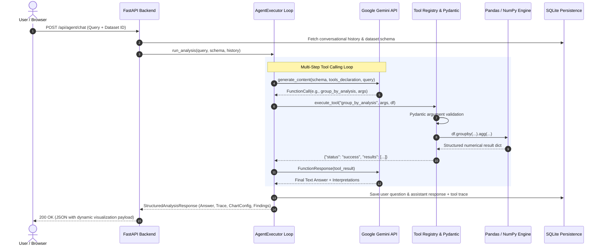

# InsightOps Architecture & Engineering Deep Dive

## 1. Zero-Hallucination Function Calling Design

Traditional LLM chatbots attempt to directly compute sums, averages, and correlations within neural token generation, resulting in frequent mathematical hallucinations. InsightOps eliminates this by restricting Google Gemini to an **Orchestration and Natural Language Interpretation Engine**, while delegating all factual operations to a deterministic Python data processing core.

## 2. Tool Architecture Matrix

InsightOps implements 27 isolated Python functions organized across five specialized analytical domains:

| Category | Tool Name | Analytical Purpose | Arguments Model |
| :--- | :--- | :--- | :--- |
| **Inspection** | `get_dataset_overview` | Shape, cells, missingness & duplicate count | - |
| | `get_column_information` | Detailed per-column dtype & unique counts | `Optional[column]` |
| | `get_data_types` | Column type mapping & type distribution | - |
| | `get_missing_values` | Granular missing value percentages per column | - |
| | `get_duplicate_records`| Exact row deduplication analysis | - |
| | `get_unique_values` | Frequency distribution for categorical columns | `column, limit` |
| **Statistics** | `calculate_mean` | Arithmetic mean with empty series safeguards | `column` |
| | `calculate_median` | 50th percentile calculation | `column` |
| | `calculate_mode` | Multimodal and frequency detection | `column` |
| | `calculate_standard_deviation` | Sample variance, std dev & variation coefficient | `column` |
| | `calculate_min_max` | Range, quartiles, IQR & extremes | `column` |
| | `calculate_correlation` | Pearson correlation with qualitative strength | `column1, column2` |
| **Business** | `calculate_total` | Sum aggregation for revenue/volume | `column` |
| | `calculate_average` | Business metric average calculation | `column` |
| | `group_by_analysis` | Multi-category aggregation (sum, mean, etc.) | `group_by_column, metric_column, agg, limit` |
| | `compare_categories` | Side-by-side category benchmarking & share % | `category_column, metric_column, categories` |
| | `calculate_percentage_change`| Time-series or sequential growth rate | `time_column, metric_column` |
| | `identify_top_performers` | Ranked descending leadership metrics | `entity_column, metric_column, limit` |
| | `identify_bottom_performers` | Ranked ascending lagging metrics | `entity_column, metric_column, limit` |
| | `detect_outliers` | IQR / Z-score outlier detection with bounds | `column, method, threshold` |
| **Visualization**| `generate_bar_chart` | Categorical bar specifications for Recharts | `x_col, y_col, title, limit, agg` |
| | `generate_line_chart` | Time-series / multi-series line configurations | `x_col, y_col, title, group_by_col` |
| | `generate_pie_chart` | Proportion / market share composition | `cat_col, metric_col, title, limit` |
| | `generate_histogram` | Frequency binning for numerical distributions | `column, title, bins` |
| | `generate_scatter_plot` | Bivariate correlation scatter configuration | `x_col, y_col, title, color_col` |
| **Reporting** | `generate_summary_report` | Global dataset executive performance summary | - |
| | `generate_data_quality_report`| Hygiene score (0-100), severity levels & fixes | - |
